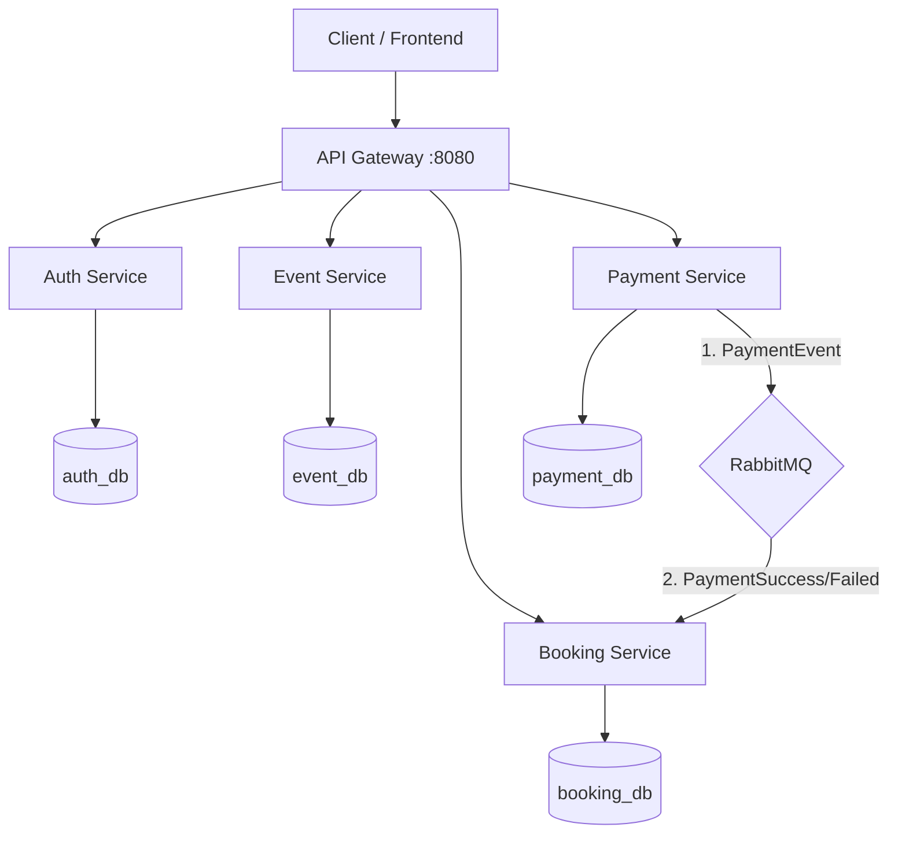

# 🎟️ Ticket Booking Microservices

    

Dự án Hệ thống Đặt vé (Ticket Booking System) được xây dựng theo kiến trúc **Microservices**. Hệ thống cung cấp các chức năng cốt lõi cho một nền tảng bán vé sự kiện chuyên nghiệp: quản lý sự kiện, xác thực người dùng, xử lý đặt chỗ và thanh toán bất đồng bộ.

---

## 🏗 Kiến trúc Hệ thống (Architecture)

Hệ thống được chia nhỏ thành các domain services độc lập. Dữ liệu của mỗi service được quản lý riêng biệt (Database-per-service) để đảm bảo tính lỏng lẻo (loose coupling). Giao tiếp giữa các service sử dụng kết hợp giữa gọi API đồng bộ và message queue bất đồng bộ.



### 🧩 Chi tiết các Microservices

1. **🚀 API Gateway (`api-gateway`)**
   - Đóng vai trò là cổng giao tiếp duy nhất (entry point) cho mọi request từ Client.
   - Xử lý Routing, Load Balancing (nếu cần), và chuyển tiếp request đến đúng service.

2. **🔐 Auth Service (`auth-service`)**
   - Xử lý xác thực người dùng (Login, Register).
   - Có thể tích hợp JWT (JSON Web Token) để quản lý phiên bản và ủy quyền.
   - Cơ sở dữ liệu: PostgreSQL (`auth_db` trên port `5432`).

3. **📅 Event Service (`event-service`)**
   - Quản lý danh mục và thông tin sự kiện (Tạo, Sửa, Xóa sự kiện).
   - Cung cấp API để tra cứu sự kiện, kiểm tra lượng vé khả dụng.
   - Cơ sở dữ liệu: PostgreSQL (`event_db` trên port `5433`).

4. **🛒 Booking Service (`booking-service`)**
   - Xử lý quy trình đặt vé của người dùng (tạo booking mới).
   - Lưu trạng thái Booking (PENDING, CONFIRMED, CANCELLED).
   - Lắng nghe event từ RabbitMQ để cập nhật trạng thái Booking sau khi thanh toán.
   - Cơ sở dữ liệu: PostgreSQL (`booking_db` trên port `5434`).

5. **💳 Payment Service (`payment-service`)**
   - Xử lý thanh toán cho Booking.
   - Sau khi xử lý thanh toán, gửi message vào RabbitMQ (`PaymentSuccessEvent` hoặc `PaymentFailedEvent`).
   - Cơ sở dữ liệu: PostgreSQL (`payment_db` trên port `5435`).

---

## ⚙️ Luồng nghiệp vụ chính (Business Flows)

### 1. Luồng Đặt vé & Thanh toán (Booking & Payment Flow)
Hệ thống sử dụng cơ chế **Event-driven** (hướng sự kiện) để đảm bảo tính nhất quán dữ liệu mà không làm chậm trải nghiệm người dùng:

1. Người dùng gọi API qua API Gateway đến **Booking Service** để tạo đơn hàng. Trạng thái đơn được gán là `PENDING`.
2. Người dùng gọi API thanh toán gửi qua **Payment Service**.
3. Sau khi **Payment Service** xử lý tiền thành công, service này gửi sự kiện `PaymentSuccessEvent` vào **RabbitMQ**.
4. **Booking Service** (đóng vai trò Consumer) nhận được sự kiện từ RabbitMQ, tự động cập nhật trạng thái đơn hàng sang `CONFIRMED` và có thể sinh vé điện tử.

---

## 🛠 Công nghệ sử dụng (Tech Stack)

- **Ngôn ngữ:** Java 17
- **Framework:** Spring Boot, Spring Cloud (API Gateway)
- **Database:** PostgreSQL (Mỗi service có một schema/database riêng)
- **Message Broker:** RabbitMQ
- **Build Tool:** Maven
- **Deployment:** Docker & Docker Compose
- **Khác:** Lombok, Spring Data JPA

---

## 🚀 Hướng dẫn cài đặt và chạy dự án (Getting Started)

### 1. Yêu cầu hệ thống (Prerequisites)
- [Java 17](https://www.oracle.com/java/technologies/javase/jdk17-archive-downloads.html)+
- [Maven 3.8+](https://maven.apache.org/)
- [Docker & Docker Compose](https://www.docker.com/)

### 2. Khởi tạo Database và RabbitMQ
Toàn bộ hạ tầng phụ trợ đã được cấu hình trong `docker-compose.yml`. Mở terminal tại thư mục gốc của dự án và chạy:
```bash
docker-compose up -d
```
Lệnh này sẽ khởi chạy:
- 4 instances PostgreSQL.
- RabbitMQ server. Bạn có thể truy cập **RabbitMQ Management Dashboard** tại: `http://localhost:15672` (User/Pass mặc định: `guest`/`guest`).

### 3. Khởi động các Microservices
Bạn cần vào từng thư mục để build và chạy ứng dụng. Khuyến nghị chạy bằng các IDE (IntelliJ, Eclipse) để dễ debug, hoặc dùng Terminal:

```bash
# Terminal 1: Chạy API Gateway
cd api-gateway
./mvnw spring-boot:run

# Terminal 2: Chạy Auth Service
cd auth-service
./mvnw spring-boot:run

# Terminal 3: Chạy Event Service
cd event-service
./mvnw spring-boot:run

# Terminal 4: Chạy Booking Service
cd booking-service
./mvnw spring-boot:run

# Terminal 5: Chạy Payment Service
cd payment-service
./mvnw spring-boot:run
```

---

## 🔌 Danh sách APIs cơ bản (API Endpoints)

*(Các API dưới đây được gọi qua API Gateway hoặc gọi trực tiếp vào Service tương ứng)*

### Booking Service (`/api/bookings`)
- `POST /api/bookings` : Tạo một đơn đặt vé mới. Body truyền vào chứa thông tin đặt vé.
- `GET /api/bookings` : Lấy danh sách tất cả các đặt vé.

### Payment Service (`/api/payments`)
- `POST /api/payments` : Thực hiện thanh toán. Payload chứa `bookingId` và số tiền, sau đó sẽ đẩy event lên RabbitMQ.

*(Các Service khác như Auth và Event sẽ được mở rộng tương tự)*

---

## 💡 Cấu trúc thư mục (Folder Structure)

```text
ticket_booking_microservices/
├── api-gateway/       # Spring Cloud Gateway
├── auth-service/      # Quản lý người dùng, JWT
├── booking-service/   # Domain đặt vé (Controller, Service, Repository, RabbitMQ Consumers)
├── event-service/     # Domain sự kiện
├── payment-service/   # Domain thanh toán, gửi RabbitMQ Events
├── docker-compose.yml # Tệp cấu hình Docker (DBs, RabbitMQ)
└── README.md          # Tài liệu dự án
```

## 🤝 Đóng góp (Contributing)
Nếu bạn muốn phát triển thêm các tính năng (VD: Notification Service để gửi Email, hoặc tích hợp Redis caching), vui lòng tạo nhánh (branch) mới và tạo Pull Request. 
Khuyến khích duy trì triết lý *Loose Coupling* giữa các Services!
